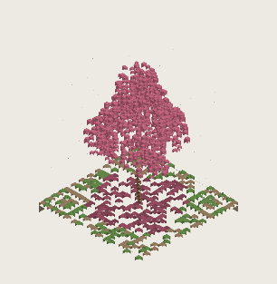
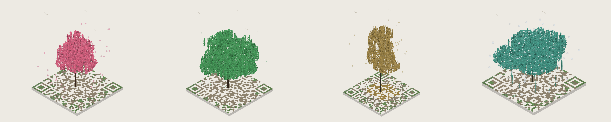
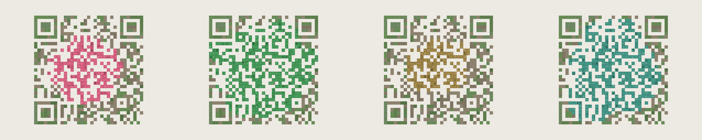

# QR Arboretum

[](https://github.com/nguyenhanhatminh0105-hue/voxel-qr-tree/actions/workflows/tests.yml)

**[Live demo](https://nguyenhanhatminh0105-hue.github.io/voxel-qr-tree/)**: runs in the browser, nothing to install.

Type a URL. It grows into an isometric voxel tree on a square plot. Tap the
plot and the camera swings to straight-down, where the whole diorama reads as a
scannable QR (Quick Response) code.



Four species, one per season: spring sakura, summer oak, autumn ginkgo, winter
willow.



Each one flattens into its own code:



Also as video: [`docs/flip.mp4`](docs/flip.mp4) (one tree) and
[`docs/seasons.mp4`](docs/seasons.mp4) (all four).

## How it works

The QR matrix is generated first, by an encoder written for this project
(`src/qr.js`, no dependencies). The scene is then planted so that **every voxel
above ground sits on a dark module**: trunk, branches, leaves, grass, all of
it. Seen from straight above, the scene reproduces the matrix exactly, whatever
shape the planting takes.

Darkness depends only on a voxel's `(x, y)` position, never its height. So a
trunk on a dark cell is dark at every level, and anything that spreads
sideways, such as a crown, is carved by the matrix. That carving is the look.

## Does it really scan?

Every result below comes from rendering the page in a real headless browser
and decoding those pixels, not from checking colours in the code.

| Check | Result |
|---|---|
| Decodes with ZBar, across 6 links × 4 seasons × 6 colour swatches | **144 / 144** |
| Decodes with OpenCV's Aruco detector, as a second opinion | 144 / 144 |
| Matrix rebuilt from rendered pixels matches the true matrix | 144 / 144, 0 modules differ |
| Decodes through a simulated phone camera (warp, blur, dim light, noise, downscale) | **432 / 432** |
| Wind and petals fully at rest in the code view | bit-identical across 3 clocks |
| Home-made QR encoder matches the [segno](https://github.com/heuer/segno) library, module for module | 592 symbols identical, 0 mismatches |

Both builds score the same on this sweep.

**Two bugs only the pixel-level check caught:**

- **The WebGL build drew the whole plot mirrored.** ZBar decodes mirrored QR
  codes without complaint, so every decode test passed. Rebuilding the matrix
  from pixels reported 468 differing modules.
- **The sweep was not testing one species at all.** A renamed species fell
  through a `|| default` lookup, so the test drew a second oak and reported
  100%. A per-species shape check exposed it, and both fallbacks now throw.

## Two builds

Same behaviour, same test suite:

| file | renderer | size | frame cost | dependencies |
|---|---|---|---|---|
| **`index.html`** | WebGL, three.js r180 vendored inline, InstancedMesh | 765 KB | 0.8 ms | none at runtime |
| `canvas.html` | canvas 2D, painter's algorithm | 73 KB | 58 ms | none at all |

Both are single files and both run from a `file://` URL with no network access.
Open either directly in a browser. (Median frame cost on the heaviest scene,
5,226 voxels at 37x37, after a warm-up in a fresh page. The WebGL figure is
software-rendered SwiftShader, so a real GPU is faster still.)

## Run the checks

```
python build.py                                   # produce index.html + canvas.html
python test/test_qr_vs_segno.py                   # encoder vs segno
python test/test_qr_decode.py                     # shipped matrices, ZBar
python test/test_render.py                        # WebGL, full sweep
python test/test_render.py --target canvas.html   # canvas 2D, full sweep
```

## Engineering notes

The full write-up is in **[docs/engineering-notes.md](docs/engineering-notes.md)**:

- **Rendering:** why the camera is orthographic, why there is no lighting, and
  one InstancedMesh per face.
- **Making it look like a tree:** see-through canopies, crown width, stacked
  bricks, the fallen-blossom carpet and proportion.
- **Contrast:** where the scan-contrast floor overrode taste, with the six
  colour swatches.
- **The QR encoder:** and its cross-check against segno.
- **Verification:** every check in detail, a measurement bug, and the bugs the
  harness found.

## Layout

```
src/qr.js            QR encoder, no dependencies
src/palette.js       colour, the contrast floor, the five-tone ladder
src/scene.js         planting: four species, ground blocks, fallen carpet
src/render.js        canvas 2D axonometric renderer
src/app.js           canvas build UI
src/three-app.js     WebGL build (reuses qr/palette/scene untouched)
build.py             inlines everything into index.html / canvas.html
test/                verification harness
vendor/              three.js, bundled to a single global with esbuild
```

`src/` exists so the modules can be unit-tested under Node; the shipped
artefacts are the two HTML files, and `build.py` asserts no external reference
survives into either.

`qr.js`, `palette.js` and `scene.js` are shared verbatim between the two
builds. Everything the code depends on — the matrix, the contrast floor, the
planting rules — is renderer-agnostic, which is also why one test harness can
drive both through the same `window.__arb` hooks.

## Licence

MIT. Bundled three.js is MIT, © three.js authors.
